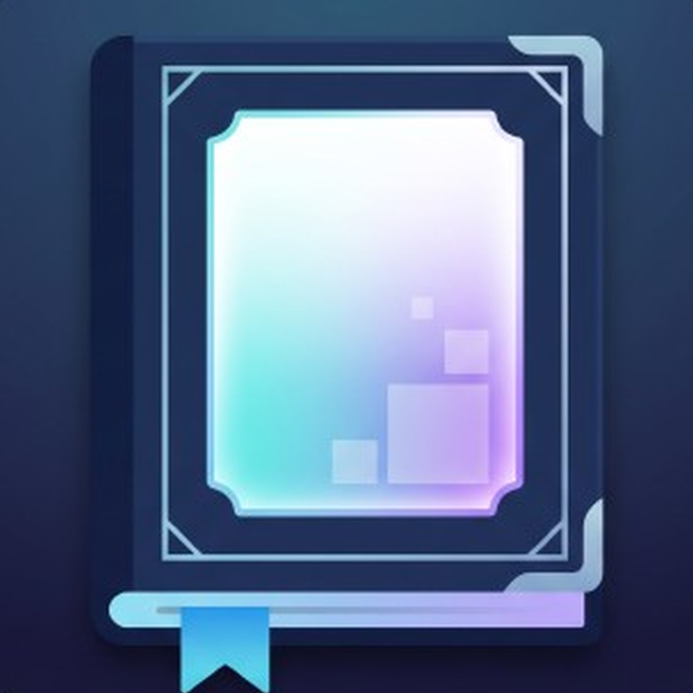
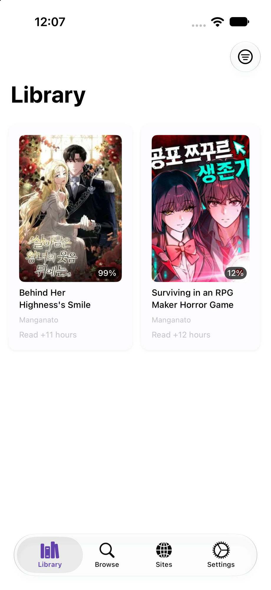
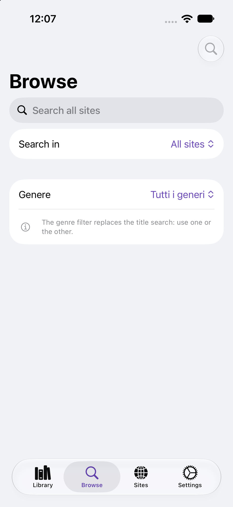
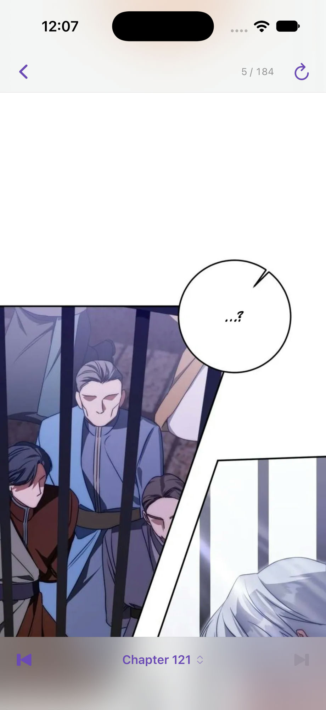
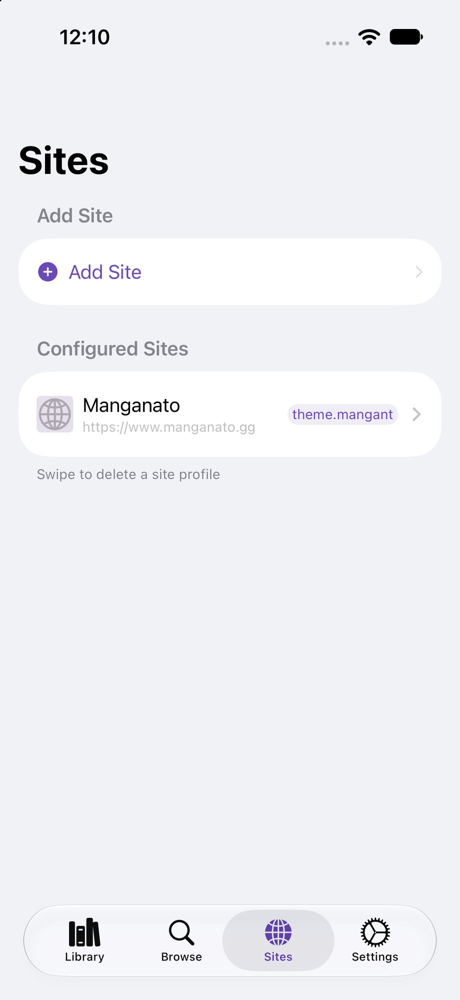
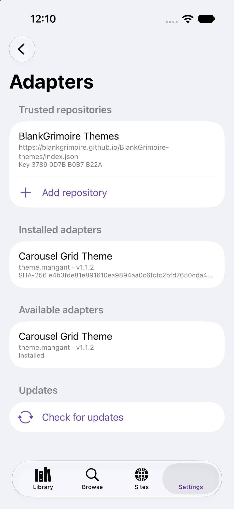
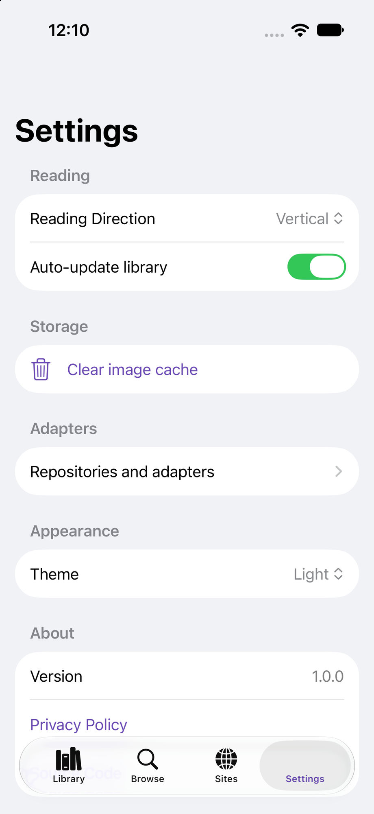

# BlankGrimoire for iOS

<p align="center">
  
</p>

<h3 align="center">A native, ad-free reader and personal library<br>for the content <b>you</b> bring.</h3>

<p align="center">
  
  
  
</p>

BlankGrimoire is an **empty container**. It ships with no content, no sources
and no pre-configured websites. You add the websites you already visit; the app
recognises common site structures through open-source *theme adapters* and
gathers everything in a single, private library.

> ⚠️ **Status:** early development. Version `1.0.0` is published and
> installable by sideloading — see [Install](#install).

## Features

- 📚 **Unified library** — every series from every site in one grid, with
  reading progress on the cover
- 🔖 **Reading progress** — resume exactly where you left off, per chapter
- 📖 **Native reader** — vertical or paged reading, prefetching, bars that get
  out of the way, chapter picker and image reload
- 🔎 **Cross-site search** — query every enabled site at once, filter by genre,
  follow each site's own pagination
- 🧩 **Theme adapters** — one adapter supports every site built on the same
  theme, installed from a signed repository
- 🚫 **Ad-free** — only the content, with full attribution to the original site
- ☁️ **iCloud sync** across iPhone and iPad (planned)

## Screenshots

| Library | Browse | Sites |
|:---:|:---:|:---:|
|  |  |  |
| Series, covers and progress | Search every site, or filter by genre | Sites you added and the detected theme |

| Adapters | Settings | Reader |
|:---:|:---:|:---:|
|  |  |  |
| Trusted repositories, installed and available adapters | Reading direction, cache, appearance | Tap to toggle the bars, pick a chapter, reload images |

## Install

Requirements: **iPhone or iPad with iOS 17 or newer**.

The app is not on the App Store. Every release publishes an unsigned IPA, so
you sign it with your own free Apple ID.

**SideStore** — install SideStore once from a computer
([how it works and how to set it up](docs/INSTALL.md)), then add this source:

```text
https://raw.githubusercontent.com/BlankGrimoire/BlankGrimoire-iOS/main/repo.json
```

Updates then arrive inside SideStore, and renewal happens on the phone over the
local VPN — no computer needed.

**Sideloadly** — download `BlankGrimoire-<version>.ipa` from the
[releases page](https://github.com/BlankGrimoire/BlankGrimoire-iOS/releases),
sign it with your Apple ID, then trust the certificate in *Settings → General →
VPN & Device Management*.

> Both routes produce a 7-day signature with a free Apple ID. SideStore renews
> it automatically; Sideloadly requires a manual reinstall each week.
>
> 📖 **For more details see [docs/INSTALL.md](docs/INSTALL.md)** — SideStore
> setup, the `3 apps` / `7-day signature` limits, automatic renewal and
> troubleshooting.

## Usage

1. **Add a site.** *Sites* → *Add Site* → enter a name and the site URL. The app
   detects the theme it is built on and shows it as a badge (for example
   `theme.mangant`). Swipe a profile to delete it.
2. **Install the adapter.** *Settings* → *Repositories and adapters* → the
   official *BlankGrimoire Themes* repository is already trusted. Install the
   adapter that matches the theme of your site; *Check for updates* keeps it
   current.
3. **Search.** *Browse* lets you search a title on all sites or on one site.
   The genre filter and the title search are mutually exclusive: choosing one
   clears the other, and the card explains it.
4. **Preview, then import.** Tapping a result opens the full series page with
   synopsis and chapter list **without** importing anything. Import from there
   to add the series to your library.
5. **Read.** Open a series in *Library* and pick a chapter, or use *Resume*.
   In the reader, tap the page to show or hide the bars: back to the series,
   previous/next chapter, page counter, chapter picker and the reload-images
   button.
6. **Tune it.** *Settings* → reading direction (vertical or paged),
   auto-update library, image cache size, light/dark appearance.

## Build from source

- Xcode 16+ · Swift 6 · [XcodeGen](https://github.com/yonaskolb/XcodeGen)
  (`brew install xcodegen`)

```bash
git clone git@github.com:BlankGrimoire/BlankGrimoire-iOS.git
cd BlankGrimoire-iOS
make gen              # generates BlankGrimoire.xcodeproj (not versioned)
make lint             # swift-format check
make test-readercore  # ReaderCore package tests (fast, no simulator)
make test             # app tests on the default iPhone simulator
make ipa              # unsigned sideloading IPA + repo.json in release/
open BlankGrimoire.xcodeproj
```

`make test-readercore` builds outside iCloud by default
(`READERCORE_SCRATCH=~/Library/Caches/BlankGrimoire/ReaderCoreBuild`). Point it
elsewhere with `READERCORE_SCRATCH=/path` if needed.

Run on a device by selecting the `BlankGrimoire` target, setting your personal
team under *Signing & Capabilities*, then pressing ⌘R. If the bundle identifier
is already taken by another team, change `PRODUCT_BUNDLE_IDENTIFIER` in
[`project.yml`](project.yml).

## Project structure

ReaderCore is a single SwiftPM target; its folders are organisational, not
separate modules.

| Path | Purpose |
|---|---|
| `BlankGrimoire/` | App target: entry point, composition root (`AppComposition`) and `Info.plist` |
| `Packages/ReaderCore/Sources/ReaderCore/Domain` | Contract DTOs (`ContractModels.swift`) and URL value types |
| `Packages/ReaderCore/Sources/ReaderCore/PluginEngine` | JavaScriptCore runtime, HTML bridge, HTTP policy, theme detection and sources |
| `Packages/ReaderCore/Sources/ReaderCore/Persistence` | SwiftData entities/schema, repositories and the signed adapter store |
| `Packages/ReaderCore/Sources/ReaderCore/ImagePipeline` | Image cache and prefetching |
| `Packages/ReaderCore/Sources/ReaderCore/Features` | SwiftUI views, view models, dependency composition and the adapter session pool |
| `Packages/ReaderCore/Sources/ReaderCore/DesignSystem` | Design tokens and shared styling |
| `Packages/ReaderCore/Tests/ReaderCoreTests` | Package tests, localization checks and the vendored contract fixtures |
| `docs/screenshots/` | Screenshots used by this README |

The remote theme repository defaults to the official GitHub Pages index. A
build can override it with the `BlankGrimoireThemesRepositoryURL` key in
[`BlankGrimoire/Info.plist`](BlankGrimoire/Info.plist) without changing code.

See [docs/ARCHITECTURE.md](docs/ARCHITECTURE.md) for details.

## SDK runtime

`runtime.js` and the contract fixtures are vendored from
[BlankGrimoire-sdk](https://github.com/BlankGrimoire/BlankGrimoire-sdk).
[`.sdk-version`](.sdk-version) records the pinned release and
[`sdk-assets.sha256`](sdk-assets.sha256) its checksums.

```bash
make sync-sdk                            # from a local checkout (../BlankGrimoire-sdk)
make sync-sdk-release                    # from the GitHub release for .sdk-version
make verify-sdk                          # re-check the vendored files
```

`make sync-sdk` never changes the pinned version unless you pass
`SDK_VERSION=<version>`. Update `.sdk-version`, run `make sync-sdk-release`,
commit the generated files and the pin together. The release sync verifies the
downloaded files against the recorded checksums when the pin is unchanged;
after a version bump it records new checksums from the release assets, so
review the diff before committing.

## Related repositories

- [BlankGrimoire-sdk](https://github.com/BlankGrimoire/BlankGrimoire-sdk): adapter contract, runtime and tooling
- [BlankGrimoire-themes](https://github.com/BlankGrimoire/BlankGrimoire-themes): official theme adapters

## Contributing

Contributions are welcome. Please read [CONTRIBUTING.md](CONTRIBUTING.md) first.

## License

[Mozilla Public License 2.0](LICENSE). Third-party components are listed in
[THIRD_PARTY_NOTICES.md](THIRD_PARTY_NOTICES.md).

## Disclaimer

BlankGrimoire does not host, provide or link to any content.
Read the full [DISCLAIMER](DISCLAIMER.md).
