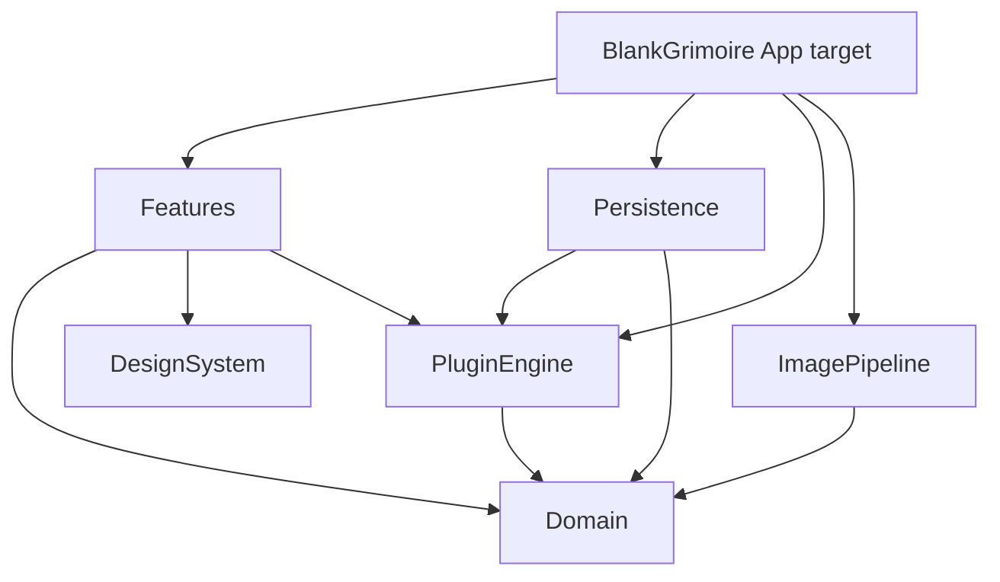
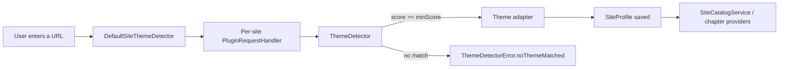
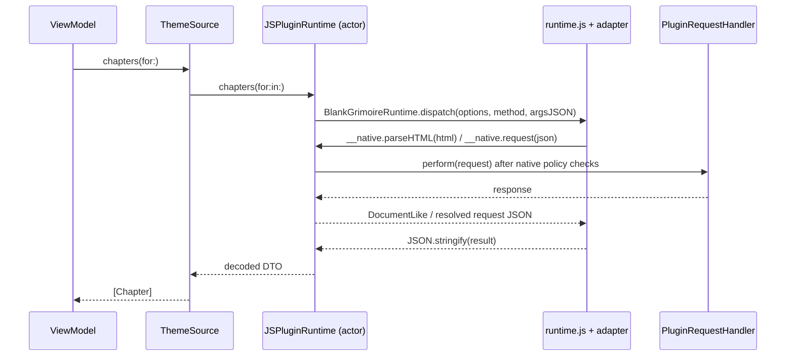

# Architecture

This document describes the high-level architecture of BlankGrimoire for iOS.
Decisions are recorded in [ADR/](ADR/).

## Goals

- **Empty container**: the app knows nothing about specific websites.
- **Source-agnostic UI**: views only see domain entities and protocols.
- **Safe extensibility**: site support comes from sandboxed, signed theme adapters.
- **Responsive by design**: parsing and image loading never block the main thread.

## Modules

The app target contains only the entry point and the composition root
(`AppComposition`). Every other type lives in the local Swift package
`Packages/ReaderCore`. ReaderCore is compiled as **one Swift module**: the
folders below are organisational boundaries, not separate targets, so the
compiler enforces access control but not folder boundaries.

| Folder | Responsibility |
|---|---|
| `Domain` | Contract DTOs (`ContractModels.swift`), identifiers, URL value types |
| `PluginEngine` | JavaScriptCore runtime, HTML/document bridge, HTTP policy, theme detection and theme sources |
| `Persistence` | SwiftData entities, schema and migrations, repository implementations, signed adapter store |
| `ImagePipeline` | Memory/disk cache, concurrent prefetching |
| `Features` | SwiftUI views and view models |
| `DesignSystem` | Colors, typography, reusable components |

## Dependency rule

Arrows always point **towards `Domain`**. Only the `BlankGrimoire` app target
constructs concrete implementations and passes them down as a
`FeaturesDependencies` value. Its required members (library and site
repositories, theme source) are plain `let`s; the add-ons that previews and
tests can omit (page/progress/bookmark repositories, theme detector, image
loader, adapter store, catalog service, chapter-pages provider) are grouped
under `OptionalFeatures`.

## Adding a site

1. `DefaultSiteThemeDetector` validates the URL, builds a request handler
   scoped to that host and runs `ThemeDetector`.
2. `ThemeDetector` fetches the home page and scores every installed adapter
   against its `ThemeSignature`. Ties are broken deterministically: score, then
   `minScore`, then selector count, then adapter id. If the best adapters are
   still tied, their `probePaths` refine the score before the same tie-break
   runs again.
3. The selected adapter is stored in a `SiteProfile` (theme id/version, host
   allowlist, optional selector overrides) and later used by
   `SiteCatalogService` and `DefaultChapterPagesProvider`.
4. `ThemeSource` is not part of detection: `LocalThemeSource` and
   `RemoteThemeSource` list the adapters available for install/update, and
   `CompositeThemeSource` merges them, tolerating a failing source and keeping
   the highest semantic version per id.

## Swift ↔ JavaScript bridge

Rules:

- **JSON is the only exchange format.** Adapters return
  `JSON.stringify(result)`; `dispatch` resolves to a JSON string, which Swift
  decodes into DTOs before mapping them to domain entities.
- **Networking is native.** Adapters never access the network directly: every
  request goes through `__native.request`, which resolves through an injected
  `PluginRequestHandler`. The handler enforces the per-site host allowlist and
  redirect policy (IOS-3).
- **HTML parsing is native.** Adapters call `__native.parseHTML`; the native
  side is the `__nativeParseHTML` block backed by `PluginDocumentStore` and
  SwiftSoup. Element and document handles stay inside the runtime; no DOM
  object crosses the actor boundary. The store rejects documents larger than
  10 MB (`PluginEngineError.documentTooLarge`), and `invoke`/`dispose` release
  the documents created during the call.
- **Load order matters.** The adapter bundle is evaluated first and its
  `BlankGrimoireRuntime` global is captured; the vendored SDK `runtime.js` is
  evaluated afterwards and must expose `__apiVersion == 1` and `dispatch`. A
  bootstrap script then wires `globalThis.__native` to the native blocks.
- `runtime.js` (prelude and declarative engine) is **built in the SDK** and
  vendored here at a pinned version (`.sdk-version`).
- **Sessions are pooled.** `AdapterSessionPool` keeps one open session per
  (site profile, adapter version) pair and hands out reference-counted leases.
  Reusing a session avoids rebuilding a `JSVirtualMachine` for every chapter
  page. A lease is never disposed on release: sessions are closed after ten
  minutes idle, when the adapter version or the profile configuration changes,
  when the adapter is uninstalled and on a memory warning.

## Contract versioning

- The adapter `apiVersion` equals the SDK major version.
- The app supports API version `1` (`ContractVersion.current`) and rejects
  incompatible adapter bundles and manifest mismatches at load time.
- `ContractTests` decode the canonical fixtures published by the SDK, so any
  contract drift fails CI.

## Concurrency

| Component | Isolation |
|---|---|
| Views and view models | `@MainActor` |
| `JSPluginRuntime` | One `actor` per adapter; each instance owns a `JSVirtualMachine` and `JSContext`, serialized by actor isolation |
| `ThemeDetector` | `actor`, sequential scoring with a bounded regex cache; ties resolved deterministically |
| `RemoteThemeSource` | `actor`, in-memory index cache with a 5-minute TTL and ETag revalidation |
| `ImagePipeline` | `actor`, with deduplicated in-flight downloads, bounded concurrency and a volatile cache that is cleared on memory warnings |
| `AdapterSessionPool` | `@MainActor`, reference-counted leases with a deduplicated open operation, idle TTL and invalidation hooks |
| `LibraryIndexReader` | `@ModelActor`, reads `LibraryEntry` snapshots on its own `ModelContext` |
| Challenge view (WKWebView) | `@MainActor` |

`JSValue` never leaves the runtime actor. The vendored runtime script is read
once and reused by every adapter session.

Site searches run with a window of at most three adapters at a time;
`searchWithTimeout` bounds each site to twenty seconds and per-site failures are
reported without discarding the other sites' results.

## Reader and page caching

- Fetched page lists are cached in SwiftData and expire after six hours, so
  signed image URLs can be regenerated. Downloaded chapters stay readable
  offline and never expire.
- `ReaderViewModel.reload()` asks the adapter for a fresh page list
  (`forceRefresh`); `load()` uses the cache. The reader prefetches the two
  pages after the current one.
- `ChallengeView` reports a `ChallengeOutcome` (`.completed` / `.cancelled`),
  including swipe-to-dismiss, so callers do not reload after a cancellation.

## Site search

`SiteCatalogService.search` queries the first result page of every enabled
site and returns `SiteSearchOutcome`. Each site's theme declares a `nextPage`
selector; the catalog reads that link from the fetched HTML (validated against
the site's own host) and returns it in `nextPageURLs`. `searchNextPage` follows
those cursors and returns the following page, so `SiteSearchViewModel` can
append results with "Load More" without re-requesting page one. Results keep
the adapter's relevance order inside each site, and sites keep their configured
order; duplicates are removed by identifier.

## Localization

User-facing text from ReaderCore is localized through
`Resources/Localizable.xcstrings`, with English as the source language and
Italian translations. Errors (`SiteBrowsingError`, `AdapterSessionError`) use
`String(localized:bundle: .module)`, so a new string is added to the catalog
instead of being hardcoded. `LocalizationTests` reads the compiled `en`/`it`
sub-bundles directly, because the test host language is fixed at launch.

## Persistence

SwiftData models: `MangaEntity`, `ChapterEntity`, `PageEntity`,
`ReadingProgressEntity`, `BookmarkEntity` and `SiteProfileEntity` (plus the
installed-adapter and trusted-repository records). Entities live in
`Persistence/Entities.swift`. Repository protocols are `@MainActor` and return
entities for reads; adapter payloads are mapped to entities in
`PluginEngine/DTOMapping.swift` before they are stored, so DTOs never leak into
the database. iCloud sync via CloudKit is planned.

The library grid does not hold entities. `MangaRepository.fetchLibraryIndex()`
returns `[LibraryEntry]` value snapshots, and the SwiftData implementation
reads them on a background `LibraryIndexReader` model actor. The grid filters
and sorts those values on the main actor; opening a series fetches its single
entity by id in `MangaDetailLoaderView` (ADR 0003).

`MangaEntity.siteProfileID` is a value link, not a SwiftData relationship:
profiles are value types shared with adapters that only understand identifiers.
Deleting a profile therefore purges its series, chapters, pages, progress and
bookmarks explicitly in `SitesViewModel`, including downloaded files that a
SwiftData cascade could not remove (DOM-04).

## Security model

- **Isolation**: one `JSVirtualMachine` per adapter, with no file-system access.
- **Allowlist**: requests are limited to hosts confirmed by the user for each site.
- **Integrity**: adapter bundles are signed with Ed25519; repository keys
  follow trust-on-first-use.
- **No hidden circumvention**: verification challenges are completed by the
  user in a **visible** web view.

## Attribution

`Attribution` is a domain entity. The pipeline never filters out credit pages,
and every series offers an "Open on site" action.

## Decision records

| ADR | Title |
|---|---|
| [0001](ADR/0001-generate-xcode-project-with-xcodegen.md) | Generate the Xcode project with XcodeGen |
| [0002](ADR/0002-declarative-theme-adapters.md) | Declarative theme adapters instead of site-specific scrapers |
| [0003](ADR/0003-background-library-index.md) | Read the library index off the main actor |
| [0004](ADR/0004-pooled-adapter-sessions.md) | Reuse adapter sessions with reference-counted leases |