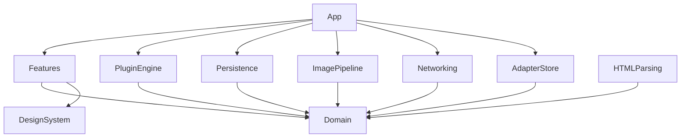
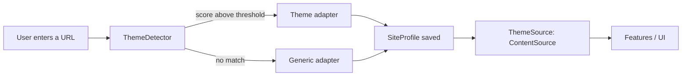
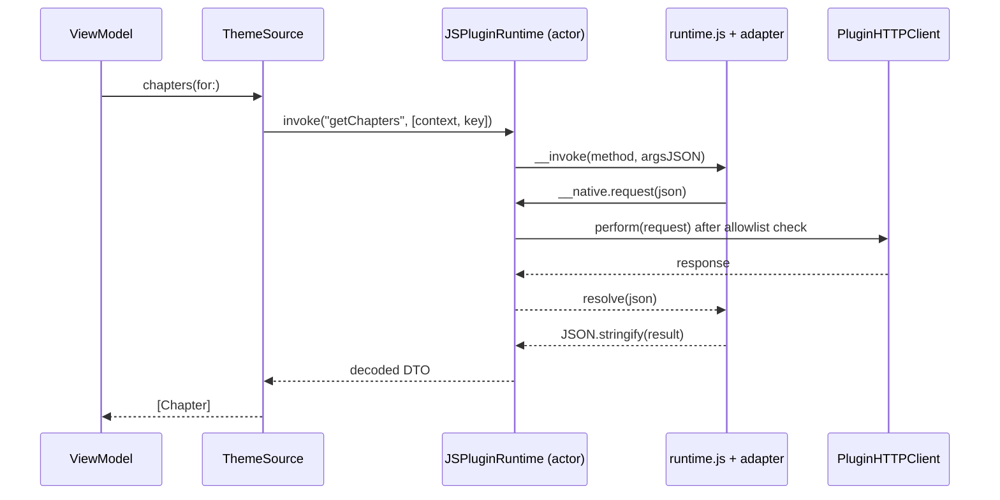

# Architecture

This document describes the high-level architecture of BlankGrimoire for iOS.
Decisions are recorded in [ADR/](ADR/).

## Goals

- **Empty container**: the app knows nothing about specific websites.
- **Source-agnostic UI**: views only see domain entities and protocols.
- **Safe extensibility**: site support comes from sandboxed, signed theme adapters.
- **Responsive by design**: parsing and image loading never block the main thread.

## Modules

All modules live in the local Swift package `Packages/ReaderCore`.
The `App` target is a thin composition root.

| Module | Responsibility | Depends on |
|---|---|---|
| `Domain` | Entities, identifiers, protocols, errors | Foundation only |
| `PluginEngine` | JavaScriptCore runtime, native bridge, DTO mapping, theme detection | `Domain` |
| `HTMLParsing` | HTML parsing exposed to the bridge (SwiftSoup) | `Domain` |
| `Networking` | HTTP client, cookie store, visible challenge view | `Domain` |
| `AdapterStore` | Adapter repositories, Ed25519 verification, install/update | `Domain` |
| `Persistence` | SwiftData models and repository implementations | `Domain` |
| `ImagePipeline` | Memory/disk cache, concurrent prefetching | `Domain` |
| `DesignSystem` | Colors, typography, reusable components | — |
| `Features` | SwiftUI views and view models | `Domain`, `DesignSystem` |

## Dependency rule

Arrows always point **towards `Domain`**. Only `App` knows concrete types.

## Adding a site

1. `ThemeDetector` fetches the home page and scores every installed adapter
   against its `ThemeSignature`.
2. The best adapter (or the generic fallback) is stored in a `SiteProfile`,
   together with the host allowlist and optional selector overrides.
3. `ThemeSource` combines adapter and profile into a regular `ContentSource`.

## Swift ↔ JavaScript bridge

Rules:

- **JSON is the only exchange format.** JS returns `JSON.stringify(result)`;
  Swift decodes it into DTOs, then maps DTOs to domain entities.
- **Networking is native.** Adapters never access the network directly: every
  request goes through `__native.request` and the per-site host allowlist.
- **HTML parsing is native.** `__native.parseHTML` exposes SwiftSoup to the
  declarative engine.
- `runtime.js` (prelude and declarative engine) is **built in the SDK** and
  vendored here at a pinned version (`.sdk-version`).

## Contract versioning

- The adapter `apiVersion` equals the SDK major version.
- The app declares a supported `apiVersion` range and rejects incompatible bundles.
- `ContractTests` decode the canonical fixtures published by the SDK, so any
  contract drift fails CI.

## Concurrency

| Component | Isolation |
|---|---|
| Views and view models | `@MainActor` |
| `JSPluginRuntime` | One `actor` per adapter, with a custom `DispatchSerialQueue` executor that owns the `JSContext` |
| `ThemeDetector` | `actor`, scoring adapters in parallel with a `TaskGroup` |
| `ImagePipeline` | `actor`, with deduplicated in-flight downloads and bounded concurrency |
| Challenge view (WKWebView) | `@MainActor` |

`JSValue` never leaves the runtime executor.

## Persistence

SwiftData models: `LibraryEntry`, `ChapterProgress`, `SiteProfile` and
`InstalledAdapter`. Repositories expose domain types only, never `@Model`
objects, to the `Features` layer. iCloud sync via CloudKit is planned.

## Security model

- **Isolation**: one `JSVirtualMachine` per adapter, with no file-system access.
- **Allowlist**: requests are limited to hosts confirmed by the user for each site.
- **Integrity**: adapter bundles are signed with Ed25519; repository keys
  follow trust-on-first-use.
- **No hidden circumvention**: verification challenges are completed by the
  user in a **visible** web view.

## Attribution

`Attribution` is a domain entity. The pipeline never filters out credit pages,
and every series offers an "Open on site" action.

## Decision records

| ADR | Title |
|---|---|
| 0001 | Generate the Xcode project with XcodeGen |
| 0002 | Declarative theme adapters instead of site-specific scrapers |